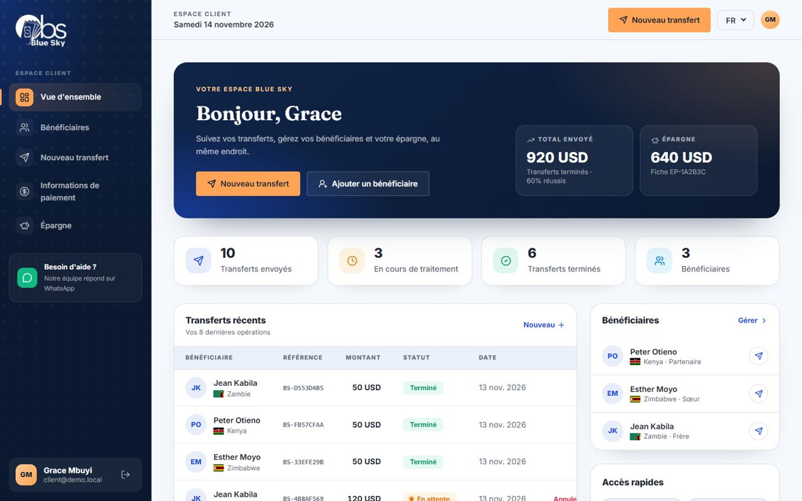
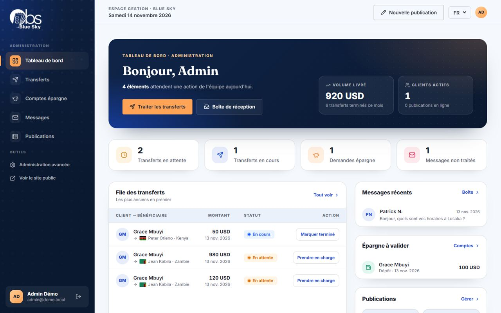

<div align="center">


# Blue Sky Money Transfer

**Transférez votre argent en toute confiance et sécurité.**<br>
Plateforme web de transfert d'argent et d'épargne entre neuf pays d'Afrique australe et de l'Est.


[Fonctionnalités](#fonctionnalités) · [Aperçu](#aperçu) · [Démarrage rapide](#démarrage-rapide) · [Architecture](#architecture) · [Déploiement](#déploiement-sur-pythonanywhere)

</div>

---

## À propos

Blue Sky est une agence de transfert d'argent spécialisée dans les transactions entre la **République démocratique du Congo, la Zambie, la Namibie, l'Afrique du Sud, la Tanzanie, le Kenya, l'Ouganda, le Zimbabwe et le Malawi**.

Ce dépôt contient le site public, l'espace client et l'espace de gestion de l'équipe. L'application est en Django pur, pensée pour un hébergement Python seul (PythonAnywhere) : aucun serveur Node.js en production, le CSS est compilé à l'avance.

## Fonctionnalités

| Espace | Ce qu'il permet |
| --- | --- |
| **Site public** | Accueil vidéo, présentation de l'agence, équipe, impact, grilles tarifaires, actualités, contact, et une page **Nos pays** où chaque capitale se fond dans le drapeau national |
| **Espace client** | Inscription avec code de vérification par e-mail, tableau de bord (total envoyé, statuts, solde d'épargne), gestion des bénéficiaires, demandes de transfert, informations de paiement par pays |
| **Épargne** | Ouverture de compte, demandes de dépôt et de retrait, suivi du solde et de l'historique |
| **Espace gestion** (équipe) | Files d'attente des transferts, des messages et de l'épargne avec actions en un clic, validation des comptes, publication des actualités |
| **Administration** | Admin Django aux couleurs de Blue Sky pour gérer les agences, tarifs, comptes de paiement et utilisateurs |
| **Multilingue** | Français (langue source), anglais et swahili |

## Aperçu

<table>
  <tr>
    <td width="50%"><br><sub><b>Accueil</b> : hero vidéo et estimation rapide</sub></td>
    <td width="50%"><br><sub><b>Nos pays</b> : capitales et drapeaux mêlés</sub></td>
  </tr>
  <tr>
    <td width="50%"><br><sub><b>Espace client</b> : vue d'ensemble</sub></td>
    <td width="50%"><br><sub><b>Espace gestion</b> : files de traitement de l'équipe</sub></td>
  </tr>
</table>

<sub>Captures réalisées avec des données de démonstration fictives.</sub>

## Démarrage rapide

**Prérequis :** Python 3.12. Node.js n'est utile que pour recompiler le CSS.

```bash
git clone https://github.com/PascalMTK/BlueSky-Website.git
cd BlueSky-Website

python -m venv .venv
source .venv/Scripts/activate        # Git Bash · PowerShell : .venv\Scripts\Activate.ps1 · macOS/Linux : source .venv/bin/activate
pip install -r requirements.txt

cp .env.example .env                 # SQLite par défaut, aucun MySQL nécessaire en local
python manage.py migrate
python manage.py createsuperuser
python manage.py runserver
```

Le site est alors disponible sur <http://127.0.0.1:8000>.

| URL | Espace |
| --- | --- |
| `/` | Site public |
| `/tableau-de-bord/` | Espace client (connexion requise) |
| `/gestion/` | Espace gestion de l'équipe (compte staff) |
| `/admin/` | Administration Django (superutilisateur) |

En local, les codes de vérification e-mail s'affichent dans la console (`EMAIL_BACKEND` console dans `.env.example`).

### Recompiler le CSS

Le fichier `static_src/css/output.css` est versionné. Recompilez-le après toute modification des templates ou de `static_src/css/input.css` :

```bash
npm install
npm run build:css      # ou npm run watch:css pendant le développement
```

### Lancer les tests

```bash
python manage.py test
```

## Architecture

| Couche | Choix |
| --- | --- |
| Backend | Django 5.2 LTS, modèle `User` personnalisé (connexion par e-mail) |
| Base de données | MySQL en production (PythonAnywhere), SQLite en local |
| Front-end | Templates Django, Tailwind CSS v4 compilé en statique, JavaScript vanilla (animations, dialogues, effets 3D) |
| Typographie | Fraunces (titres) et Inter (interface) |
| Configuration | `python-decouple` et fichier `.env` |

```text
config/        Réglages, URLconf racine, WSGI
core/          Gabarits de base, données du site (core/data.py), balises de template (icônes, UI, i18n)
accounts/      Modèle User, inscription, vérification par code, connexion
marketing/     Pages publiques, agences, tarifs, informations de paiement, messages de contact
transfers/     Espace client : bénéficiaires et transferts
savings/       Comptes épargne et opérations
staffpanel/    Espace gestion de l'équipe
blog/          Actualités
static_src/    Sources CSS/JS, images, drapeaux SVG, photos des capitales
docs/assets/   Logo et captures d'écran du README
```

Les pays et agences affichés sur le site se gèrent depuis l'admin (**Site public & agences › Agences**). Les photos des capitales associées à chaque code pays sont déclarées dans `core/data.py` (`CAPITALS`).

## Déploiement sur PythonAnywhere

1. **Code** : dans une console Bash, `git clone` le dépôt.
2. **Environnement virtuel** :
   ```bash
   mkvirtualenv --python=python3.12 bluesky-env
   pip install -r requirements.txt
   ```
3. **Base de données** : créez une base MySQL depuis l'onglet *Databases* et notez l'hôte, l'utilisateur et le mot de passe.
4. **Variables d'environnement** : dans l'onglet *Web* (ou dans un `.env` à la racine) :
   `SECRET_KEY`, `DEBUG=False`, `ALLOWED_HOSTS=<utilisateur>.pythonanywhere.com`, `DB_ENGINE=mysql`, `DB_NAME=<utilisateur>$bluesky`, `DB_USER=<utilisateur>`, `DB_PASSWORD=...`, `DB_HOST=<utilisateur>.mysql.pythonanywhere-services.com`, `DB_PORT=3306`, ainsi que les réglages SMTP (`EMAIL_*`).
5. **Migrations** :
   ```bash
   python manage.py migrate
   python manage.py createsuperuser
   ```
6. **Fichiers statiques** : compilez le CSS en local (`npm run build:css`), committez `static_src/css/output.css`, puis sur PythonAnywhere :
   ```bash
   python manage.py collectstatic --noinput
   ```
   Dans l'onglet *Web*, ajoutez le mapping statique : URL `/static/` vers `/home/<utilisateur>/<projet>/staticfiles`.
7. **Fichier WSGI** : dans la section *Code* de l'onglet *Web*, faites pointer le fichier WSGI vers `config.wsgi.application` (décommentez et ajustez `sys.path` et `DJANGO_SETTINGS_MODULE` dans la partie Django).
8. **Rechargez** l'application depuis l'onglet *Web*.

## Crédits

- Photos des capitales : [Wikimedia Commons](https://commons.wikimedia.org/), sous licences Creative Commons (CC BY / CC BY-SA). Les auteurs sont cités sur la page *Nos pays* et dans `core/data.py`.
- Drapeaux nationaux : Wikimedia Commons, domaine public.
- Icônes : [Lucide](https://lucide.dev/) (ISC).

---

<div align="center">
<sub>© Blue Sky Money Transfer · Lubumbashi, RDC · Tous droits réservés</sub>
</div>
